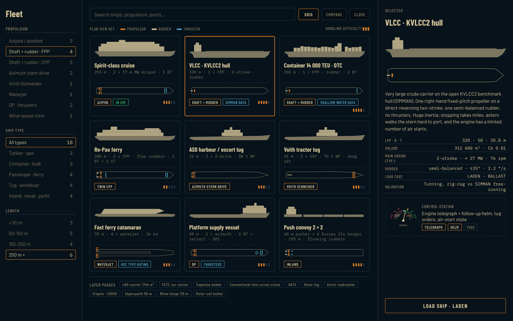
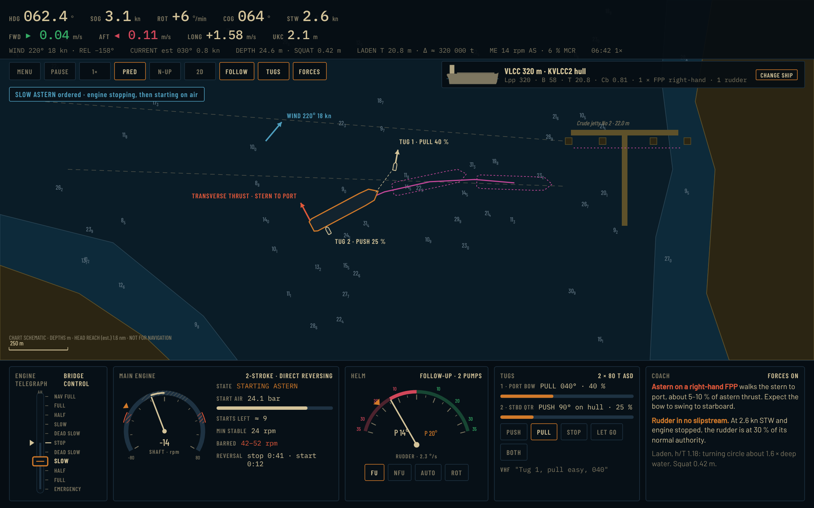
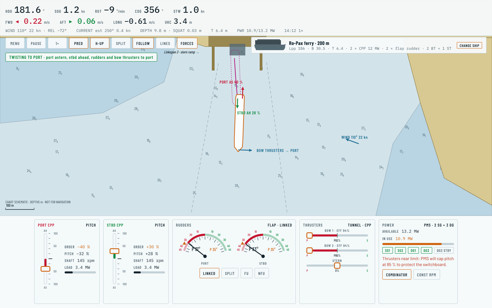
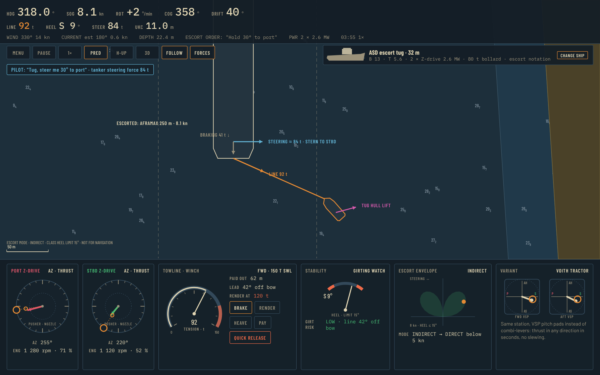
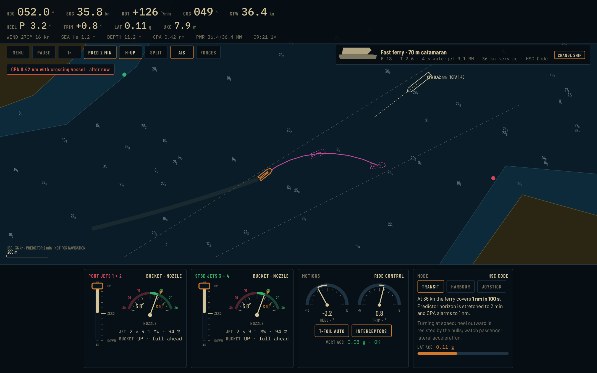
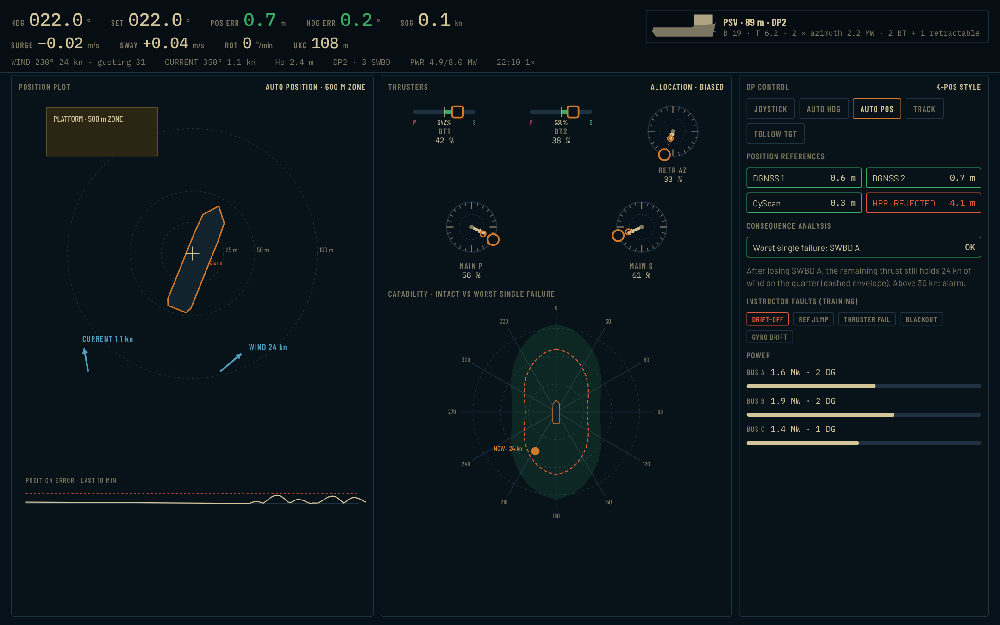
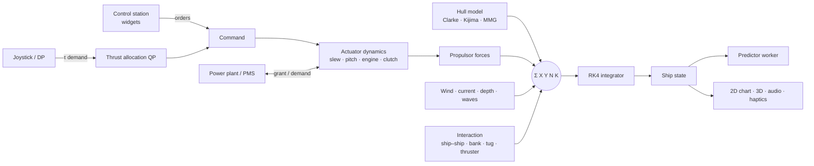
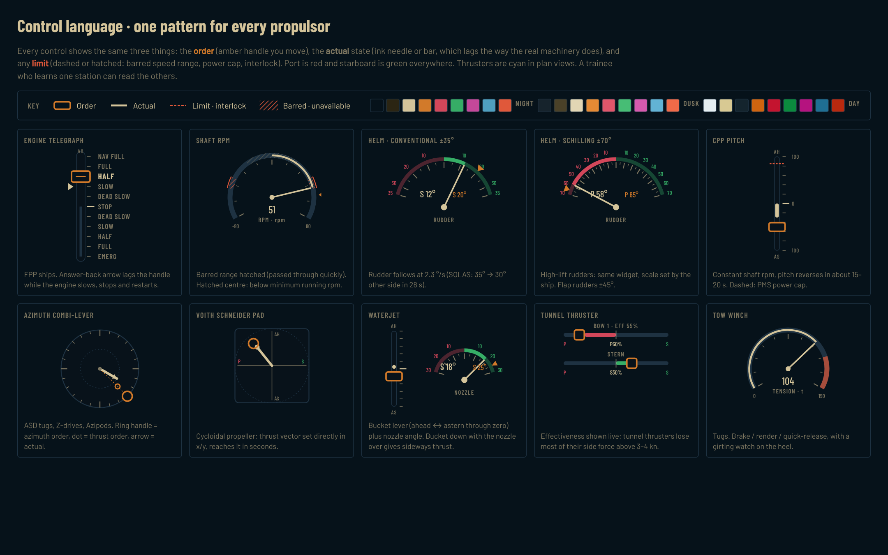
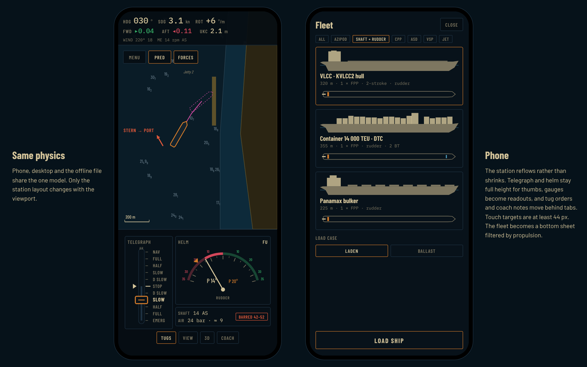

# Fleet & Propulsion Expansion Plan

**Goal:** turn Azipod Bridge from a twin-Azipod cruise-ship trainer into a ship-handling simulator that covers every common propulsion system, from a 31 m tractor tug to a 400 m container ship, without losing what makes the current app good: a published-model physics core that is checked against real data, a station a trainee can read at a glance, and one build that runs on a phone, a desktop and offline.

**Status:** proposal. Nothing in this document is implemented yet. The mockups in [`mockups/`](mockups/) are design targets rendered from code (`node docs/expansion/mockups/render.mjs`), not screenshots of the app.

---

## 1. Summary

| | Today | After this plan |
|---|---|---|
| Propulsion | Twin Azipod (pulling pods, electric) + tunnel bow thrusters | + fixed-pitch and controllable-pitch shafts with rudders (single and twin), high-lift rudders, azimuth stern drives / Z-drives, Voith Schneider, waterjets, DP thruster suites, inland pushboat steering, rotor sails |
| Machinery | One shared switchboard | Direct-reversing two-stroke (air starts, barred rpm, reversal time), geared medium-speed with clutch, diesel-electric with power management, hybrid battery |
| Ships | 3 (all Azipod, 130–293 m) | ~18 across 9 categories, 31–400 m, including three open benchmark hulls (KVLCC2, KCS, DTC) with published free-running data for validation |
| Physics | 3-DOF, Clarke derivatives (slender hulls) | 3-DOF + roll (4-DOF) where heel matters, full-hull derivatives (Kijima / MMG standard), load cases, type-specific wind loads, ship–ship interaction, towline dynamics |
| Stations | Azipod dials + RPM levers + bow thruster + joystick | Seven station families built from one shared widget set (telegraph, helm, CPP lever, combi-lever, VSP pad, waterjet, DP) |
| Training | Scenario per ship | Free choice of ship × harbour × conditions, coach overlay, assessment, debrief, instructor fault injection |

**Delivery order** (section 8): refactor first (no behaviour change), then shaft + rudder ships (the largest share of the world fleet and the biggest training gap), then twin-screw CPP ferries, tugs, fast craft, DP, and inland and special ships.



---

## 2. Where the simulator is today

Strengths to keep and build on:

- **Physics core** (`src/physics/sim.ts`): Fossen/MMG-form 3-DOF with rigid-body and added-mass Coriolis (including the Munk moment), strip-wise cross-flow drag with local current, ITTC-57 resistance, shallow-water factors, RK4 at 20 Hz. The pod model is unusually complete: K_T(J) thrust, second-quadrant braking, strut lift, propeller cross-flow momentum drag (Glauert actuator disk), hull-wash and pod-to-pod losses.
- **Validation habit:** `npm run validate` compares against published 277 m twin-Azipod stopping tests, and `npm run trials` produces IMO-style sea trials. Every new ship type should arrive with the same kind of check.
- **Harbour physics:** squat, bank suction, pod wash off walls, fenders, mooring lines, tugs, a real NOAA ENC chart.
- **Design language:** ECDIS-style day/dusk/night palettes, Barlow Condensed labels, IBM Plex Mono readouts, and the "handle = order, bar = actual" convention on the RPM levers. The mockups extend this rather than replacing it.

What is hard-wired to "two pods + one bow thruster" and has to be generalised first (21 references across 11 files):

- `ShipSpec.pods: PodSpec[]` and a single `bowThruster`. The pod force loop in `Model.accel` is Azipod-specific.
- `allocation.ts` solves a closed-form 5-unknown problem that assumes exactly two pods and one bow thruster.
- `ShipState.pods` / `Command.pods` / `bt`, the lever modes (`twin` / `indep`) and the tray in `index.html` all assume pods.
- `deriveHydro` uses Clarke, Gedling & Hine (1983) regressions, which suit slender ships. They are weak for full hulls (VLCC, bulk carriers, Cb above 0.8).
- Ships are chosen by scenario (`scenarios.ts` → `setShip`). There is no free choice of ship.

---

## 3. Propulsion systems to add

Each entry lists the force model, actuator dynamics and limits, what it teaches, and its control station. Formulas follow the MMG standard method (Yasukawa & Yoshimura 2015) unless noted, so they plug straight into the existing `X, Y, N` sums.

### 3.1 Fixed-pitch propeller + rudder, single screw (FPP)

The most common arrangement at sea, and the one the simulator lacks entirely.

- **Propeller:** four-quadrant thrust and torque from Wageningen B-series C_T*(β) data. This covers ahead, astern, and the propeller going astern while the ship still has headway (crash stop). Effective wake w_P and thrust deduction t_P vary with drift angle and yaw rate (MMG).
- **Rudder:** normal force F_N = ½ ρ A_R U_R² f_α sin α_R. Inflow u_R combines the propeller slipstream, ε u_P √(η{1 + κ(√(1 + 8K_T/πJ²) − 1)}² + (1 − η)), with the hull flow-straightening term γ_R. Hull–rudder interaction (a_H, x_H) and rudder drag t_R come from the same MMG set. **Teaching consequence:** with the engine stopped the rudder loses most of its slipstream. "Kick ahead" (a short burst of rpm with the rudder hard over) becomes a real technique instead of a myth.
- **Transverse thrust (propeller walk):** a lateral force at the stern. It is small ahead and roughly 5–10 % of thrust astern according to ship-handling texts (secondary sources disagree on the exact figure; Brix's *Manoeuvring Technical Manual* is the reference to obtain). A right-hand FPP going astern walks the stern to port. Implement as Y_P = k_TT(J, quadrant) · |T| with k_TT calibrated per ship, and expose it in the coach overlay.
- **Engine: direct-reversing two-stroke.** This is what makes big-ship handling hard, and it is worth modelling properly:
  - Telegraph steps map to an rpm table: Dead Slow is roughly the minimum stable running speed, and Nav Full exists only at sea.
  - **Barred speed range** (torsional vibration): the engine may pass through it but not dwell. The governor jumps across it, and dwelling raises an alarm.
  - **Reversal:** stop fuel, wait for the shaft to slow, apply start air in the astern direction, then fuel. The engine cannot start astern against a windmilling propeller at speed. Model the shaft as torque balance (I_shaft ω̇ = Q_engine − Q_prop(J)) so this emerges from the physics rather than a timer.
  - **Start-air budget:** bottle pressure falls with each start. Classification practice is on the order of 12 consecutive starts for a reversible engine (6 for CPP installations), and astern starts use more air. Running out of starting air is a classic scenario.
  - Load programme, torque/scavenge limiter, slowdown and shutdown.
- **Steering gear:** SOLAS requires 35° on one side to 30° on the other in 28 s or less (≈ 2.3 °/s) with one pump unit. Two pumps roughly double that rate. Modes: follow-up (FU), non-follow-up (NFU), autopilot, ROT-mode.
- **Station:** engine telegraph with answer-back, follow-up helm with rudder angle indicator (RAI), shaft rpm gauge showing the barred range, air-start state. See mockup 02.



### 3.2 Controllable-pitch propeller + rudder (CPP)

- Shaft runs at constant (or combinator-scheduled) rpm; thrust comes from pitch ratio P/D(t) with a pitch rate limit (typically 15–20 s from full ahead to full astern).
- Four-quadrant data as a function of pitch. **Zero pitch is not zero effect:** at zero pitch the disc blocks the flow and shields the rudder. A CPP slowed too fast leaves turbulent, blanketed flow over the rudder.
- **Transverse thrust reverses its sense going astern.** The shaft keeps turning the same way, so a right-hand CPP going astern on pitch walks the stern the opposite way to a right-hand FPP. This is commonly taught; treat the magnitude as a calibration constant.
- Combinator curves (pitch and rpm together) versus constant-rpm mode with shaft generators. The power management system (PMS) can cap pitch when the switchboard is loaded.
- **Station:** CPP pitch lever per shaft (order, actual pitch, PMS cap), shaft rpm readout, combinator / constant-rpm mode.

### 3.3 Twin screw (FPP or CPP) with twin rudders

- Two propellers at ±y. **Twisting** (one ahead, one astern) gives yaw moment with little net surge. Outward-turning and inward-turning screws differ in walk and in how well they twist; make the turning direction a ship parameter.
- Twin rudders, each in its own slipstream, linked or split. Centreline-rudder twin-screw ships (older ferries) are worse at low speed because the rudder sits outside both slipstreams. That comes out of the same model.
- **Station:** two telegraphs or two CPP levers, twin RAI, thrusters. See mockup 03.



### 3.4 High-lift rudders: flap (Becker) and fishtail (Schilling)

- **Flap rudder:** a trailing-edge flap deflects more than the rudder. Wärtsilä quotes 60–70 % higher maximum lift than a conventional rudder of the same area, with rudder angles to about ±45°. Becker quotes flap angles up to 65°.
- **Schilling rudder:** usable to ±70° with no abrupt stall (Becker quotes 65–70° for turning on the spot at zero speed).
- **Model:** the same rudder equation with a per-type lift curve f_α(α) that includes post-stall behaviour. A conventional NACA section stalls around 35–45°; high-lift sections keep lift much further. Parametrise as C_L(α) tables per rudder type.
- **Station:** the same RAI widget with its scale set by the ship (±35, ±45, ±70).

### 3.5 Azimuth thrusters, Z-drives and azimuth stern drives (ASD)

What separates these from the existing Azipod:

| | Azipod (existing) | Z-drive / ASD |
|---|---|---|
| Drive | Electric motor in the pod | Diesel → shaft → bevel gears; clutch with slip at low rpm |
| Propeller | Pulling, open | Usually pushing, in a nozzle (Kort, 19A / Ka-series) |
| Slew | ~6–7.5 °/s (big pods) | Much faster on tugs; take it from vendor data per unit |
| rpm response | ~30 s to full | Seconds (engine and clutch dynamics) |
| Typical use | Cruise, ferries, icebreakers | Harbour and escort tugs, OSVs, ferries |

- **Nozzled propeller:** K_T split between propeller and duct, from ducted-propeller series data. More bollard pull, a different astern ratio and higher drag at speed.
- **Thrust vectoring** reuses most of the existing pod code: the strut and housing as a lifting surface, cross-flow momentum drag, and interaction losses including thruster-on-thruster wash, which is critical on tugs with units 3–4 m apart.
- **Station:** azimuth combi-lever per unit (ring handle = azimuth order, dot = thrust order, arrow = actual). Optional "both levers linked" and a joystick. See mockup 04.

### 3.6 Voith Schneider propeller (VSP, cycloidal)

- Vertical-axis rotor with blades whose pitch varies cyclically. The thrust vector is set in magnitude and direction by moving one control point (the "normal law" of Ernst Schneider), so **any direction in a few seconds, with no slewing**.
- **Model:** a vector-thrust actuator. T = f(n, eccentricity e), with direction from the control point (e_x, e_y), first-order dynamics of a few seconds, and open-water efficiency from published VSP data. A 2026 study uses an equivalent pitch ratio as the propulsion-state coordinate, which is a good basis for a low-order model.
- **Voith Water Tractor:** units forward of amidships, a large skeg aft, towing point aft. The skeg is a lifting surface that makes the tractor directionally stable and very effective in indirect escort.
- Reference ship: 31.5 × 12.5 m, 2 × VSP 32R5/265-2, 2 × 2 670 kW, 70 t bollard pull (Haifa *Ilan*; Transnet's 31 m tugs are similar).
- **Station:** one VSP pitch pad per unit (x/y) plus the Voith steering wheel option. Shown as the variant panel in mockup 04.



### 3.7 Waterjets

- Thrust from momentum flux: T = ṁ (V_jet − (1 − w) V_ship), with ṁ = ρ A_nozzle V_jet. Efficiency rises with speed, and waterjets beat propellers above roughly 30 kn (Wärtsilä).
- **Steering nozzle** deflects the jet (about ±30°). The **reversing bucket** redirects it forward and downward. Blending the bucket with the nozzle angle gives any thrust direction: bucket fully down with the nozzle centred gives straight astern with no side force, and with the nozzle angled the bucket's flow channel can produce a side force larger than the nozzle angle alone (Rolls-Royce/Kamewa patents). Model the bucket–nozzle mapping as a 2-D lookup to (T_x, T_y, x-application point).
- No rudder. Low-speed manoeuvring comes from jet vectoring and a bow thruster, often through a single joystick.
- **Station:** bucket lever (ahead ↔ zero ↔ astern) and nozzle indicator per jet or jet pair, helm or tiller, mode TRANSIT / HARBOUR / JOYSTICK, motion and ride-control readouts. See mockup 05.



### 3.8 Tunnel thrusters (bow and stern), generalised

- Today: one lumped bow thruster with effectiveness 1/(1 + (u/1.6)²). Generalise to N tunnels at any x, FPP or CPP, each with its own power.
- Effectiveness versus speed after Chislett & Björheden (1966) and Brix: side force falls sharply with headway, reported as low as 10 % of static at about 3 kn, and practically useless above 5–6 kn. Keep the curve per hull and expose it live ("EFF 55 %").
- Immersion: ventilation and thrust loss in ballast when the tunnel is near the surface.

### 3.9 DP thruster suites and generalised thrust allocation

- **Actuator set:** main azimuths, tunnels, retractable azimuth. Each has thrust limits, azimuth-rate limits and **forbidden zones** (sectors where the wash hits another thruster or the hull).
- **Allocation:** replace the closed-form 2-pod solver with a small quadratic program, minimising Σ wᵢ Tᵢ² + slack penalty subject to B(α) T = τ, rate limits and forbidden zones. Use an active-set solver in TypeScript with no dependencies; it can sit in the predictor worker. MARIN's work on interaction-aware allocation is the reference for adding efficiency factors.
- **DP model:** PD/PID on estimated position and heading with wind feed-forward, reference systems (DGNSS, laser, HPR) with weighting and rejection, and a power plant with split buses.
- **Capability plots:** environmental envelope for intact and worst-case single failure, computed offline per ship. DNV-ST-0111 is the reference method.
- **Station:** position plot, thruster panel, capability plot, mode buttons (Joystick / Auto Heading / Auto Position / Track / Follow Target), consequence analysis and instructor faults. See mockup 06.



### 3.10 Inland pushboat steering

- Twin or quad screws in Kort nozzles, multiple steering rudders aft of the propellers, and **flanking rudders** ahead of them for control going astern.
- A rigidly connected convoy is one body with configuration-dependent coefficients. Delefortrie, Villagómez & Verwilligen (J. Ship Research 2022) give a 6-DOF push-convoy model from captive tests, validated with skippers, that covers turning on the spot.
- **Station:** steering-rudder lever, flanking-rudder lever, engine levers, rate-of-turn indicator (central on inland radar).

### 3.11 Wind-assisted propulsion (rotor sails, rigid sails)

- Flettner rotors: Magnus lift C_L(spin ratio) and drag, with yaw moment from the rotor's x position. Rigid wing sails (e.g. *Wind Challenger* on the LNG carrier *Fujin Sailor*, sails about 49 m high) act as wings with an angle of attack.
- For manoeuvring training they matter as **windage that can be switched**: furled versus deployed changes drift and yaw in port.

### 3.12 Machinery and power layer (cross-cutting)

A `PowerPlant` model sits between the levers and the propulsors:

- **Diesel-mechanical:** engine torque/rpm map, governor, clutch, shaft generator.
- **Diesel-electric:** gensets with load ramp rates, a PMS with load-dependent start/stop, **load shedding and blackout recovery**. The existing shared switchboard grows into this.
- **Hybrid battery:** instant power for peaks, then gensets catch up.
- **Gas turbine** (naval CODAG/CODOG): fast power but strict CPP pitch schedules.
- Failures for the instructor: engine trip, blackout, CPP hydraulic failure (pitch fails ahead or astern), steering pump failure, thruster trip, air-start exhausted.

### 3.13 Considered and deferred

Contra-rotating pod + propeller (CRP), double-ended ferries (Azipods or VSPs at both ends), pump-jet and Gill thrusters, sailing ships (needs a sail model and 6-DOF). All fit the propulsor interface below and can come later.

---

## 4. Ships to add

Sizes span 31 m to 400 m. Particulars marked *open* come from published benchmark data. The rest are **representative** of real classes and must carry an in-app provenance note, the way the current Lady-class and Spirit-class ships do ("modelled on published particulars; hull form, windage … are estimates").

### 4.1 Benchmark hulls (credibility first)

Benchmark hulls have published captive-test coefficients and free-running trials (SIMMAN 2008, 2014 and 2019/2020, including shallow water), so the model can be scored against real data before anyone trains on it.

| Ship | Particulars | Propulsion | Why |
|---|---|---|---|
| **VLCC, KVLCC2 hull** *open* | Lpp 320, B 58, T 20.8 m, Cb 0.81, ∇ 312 600 m³ | 1 × FPP right-hand, 1 rudder, direct-reversing 2-stroke | Full-form, nearly course-unstable, huge inertia; MMG standard method example ship, SIMMAN deep and shallow data |
| **Container ship, KCS hull** *open* | Lpp 230, B 32.2, T 10.8 m, Cb 0.651 | 1 × FPP, 1 rudder, bow thruster | Fine-form fast ship; SIMMAN deep and shallow data |
| **ULCV, DTC hull** *open* | 14 000 TEU, Lpp ≈ 355, B ≈ 51, T 14.5 m | 1 × FPP, rudder, 2 BT | Extreme-shallow-water free-running data (h/T to 1.1); windage of a stacked deck |

### 4.2 Merchant

| Ship | Representative particulars | Propulsion | Training value |
|---|---|---|---|
| ULCV 24 000 TEU | 400 × 61.3 m, T 14.5–16.5 m, ≈ 58 MW | 1 × FPP, 2-stroke, rudder, 2–3 BT | The biggest windage in port, tug-dependent |
| Capesize bulker | ≈ 292 × 45 × 18 m | 1 × FPP, rudder, no BT | Laden versus ballast contrast; tugs only |
| Panamax / Handysize bulker | 225 / 180 m | 1 × FPP, rudder | Entry-level "big single screw" |
| LNG carrier 174 000 m³ | ≈ 295 × 46.4 m | 1 or 2 × FPP (twin-skeg variant), dual-fuel | High freeboard and windage; twin-skeg handling |
| PCTC car carrier | ≈ 200 × 32 × 9.5 m | 1 × FPP or CPP, rudder, BT | A sail with an engine: wind dominates at low speed |
| MR product tanker | ≈ 183 × 32 × 12 m | 1 × FPP, rudder, BT | Most common coastal tanker |

### 4.3 Passenger

| Ship | Particulars | Propulsion | Training value |
|---|---|---|---|
| Spirit / Lady / Bécancour (existing) | 135–293 m | 2 × Azipod | Kept bit-for-bit |
| Conventional twin-screw cruise | ≈ 260 m | 2 × CPP, twin rudders, 3 BT + 2 ST | Compare with Azipod on the same berth |
| Ro-Pax ferry | ≈ 200 × 30.5 × 6.4 m | 2 × CPP, 2 flap rudders, 2 BT + 1 ST | Stern-to linkspan berthing, twisting, PMS limits |
| Fast ferry catamaran | ≈ 70 m, 36 kn | 4 × waterjet | HSC type rating, closing speeds, heel and comfort |
| River cruise ship | ≈ 135 × 11.4 m | 2 × azimuth or twin screw + bow unit | Locks, low air draught, strong current |

### 4.4 Tugs and workboats

| Ship | Particulars | Propulsion | Training value |
|---|---|---|---|
| ASD harbour / escort tug | ≈ 32 × 13 m, 80 t BP | 2 × Z-drive, nozzled | The most common tug; escort in indirect mode |
| Voith tractor tug | 31.5 × 12.5 m, 70 t BP | 2 × VSP 32R5, skeg aft | Tractor technique, stable escort |
| Rotor tug | ≈ 32 m | 3 × azimuth (2 fwd, 1 aft) | Redundant 360° pushing and pulling |
| Platform supply vessel | ≈ 89 × 19 m, DP2 | 2 × azimuth + 2 BT + retractable | DP operations, 500 m zone, faults |
| AHTS | ≈ 80 m | 2 × CPP + high-lift rudders + thrusters | Twin-CPP DP, towing |

Tugs as own ship need extra physics (section 5.5). The same tug models also become **AI tugs** that respond to pilot orders, replacing today's force-only tugs.

### 4.5 Inland, naval, special

| Ship | Particulars | Propulsion | Training value |
|---|---|---|---|
| Push convoy 2 × 2 | 40 m pusher + 4 Europa IIa barges (76.5 × 11.4 m), ≈ 193 m | 2–3 screws in nozzles, steering + flanking rudders | River bends, current, bridges |
| Rhine motor barge | 110 × 11.4 m | 1–2 screws, bow thruster | Single-screw inland |
| Frigate (DTMB 5415 / ONRT hull) *open* | Lpp ≈ 142, B ≈ 19 m | 2 × CPP, twin rudders, CODAG | High speed, gas-turbine power limits; SIMMAN data |
| Polar icebreaker / Arctic tanker | ≈ 150–250 m | 2–3 × Azipod | Double-acting (astern in ice); ice model later |
| Superyacht | ≈ 90 m | 2 × FPP + stern and bow thrusters, joystick | Small-crew close-quarters handling |

### 4.6 Load cases

Every ship gets at least **laden** and **ballast** cases: draught and trim, Cb, windage area and centre, rudder and propeller immersion (a propeller partly out of the water in ballast loses thrust and walks more). These are where the same hull handles like two different ships.

---

## 5. Physics and modelling upgrades

### 5.1 Hull forces for every hull form

- Keep Clarke (1983) for slender hulls; it is validated in this codebase.
- Add **Kijima et al. (1990)** regressions for full hulls (Cb, trim and B/L enter explicitly) and the **MMG standard** formulation with per-ship override tables, so a benchmark hull uses its published coefficients directly.
- A coefficient source tag is shown in the ship's provenance note: *published captive test*, *regression*, or *estimate*.

### 5.2 Shallow water

- Depth factors from Kijima / Ankudinov (valid to about h/T ≈ 1.085) replace the single `fsh` scaling. Model-test evidence to reproduce: fine ships' turning circles grow steadily as depth falls; full ships become course-unstable near h/T ≈ 1.5; extreme shallow water (h/T ≈ 1.1) worsens turning sharply (DTC 2026 tests). Validate against SIMMAN KVLCC2/KCS shallow cases and the DTC data.

### 5.3 Roll (4-DOF) where heel matters

Tugs (heel under towline load, girting), fast craft (heel in turns, passenger comfort), container ships and PCTCs (outward heel in turns, wind heel). Add roll with GM, roll damping and roll-coupled sway and yaw terms. Keep 3-DOF for ships where roll does not matter to handling, to protect phone performance.

### 5.4 Environment

- **Wind by ship type:** Blendermann / Fujiwara coefficient sets (C_X, C_Y, C_N against apparent wind angle) per type and load case, instead of today's three-constant Isherwood-style fit. For container ships, use a reference pressure with a height profile: Blendermann notes it can be 2–3 × the 10 m value.
- **Waves (later):** mean drift forces and added resistance for open-water scenarios. Full seakeeping is out of scope.

### 5.5 Interaction and towing

- **Ship–ship interaction:** passing and overtaking ships and a moored ship affected by a passing ship (Varyani et al. 2002/2004, Varyani & Vantorre 2006 empirical models, designed for simulators). This also covers tug–ship interaction near the bow (suction) and the danger of a tug working under the bow.
- **Towline:** elastic line with winch modes (brake, render, heave, pay out, quick release), a towing point per tug type, line force fed to both ships. Escort forces emerge from the tug's hull lift. Expect indirect steering forces of about 1.75–1.85 × bollard pull between roughly 5 and 12 kn, switching to direct below 4–5 kn. Track heel against the class limit, and girting when the line comes abeam.

### 5.6 Ice (special ships, later phase)

Lindqvist (1989) level-ice resistance (crushing, bending, submersion) as a speed-dependent force, ahead and astern for double-acting ships. The Krylov-validated static/dynamic approach in J. Mar. Sci. Eng. (2020) is the template.

### 5.7 Validation suite (extends `npm run validate` / `npm run trials`)

For every ship, automated and run in CI:

1. **IMO MSC.137(76) manoeuvres:** turning circle (advance ≤ 4.5 L, tactical diameter ≤ 5 L), initial turning (≤ 2.5 L travelled by 10° heading change at 10° rudder), 10/10 and 20/20 zig-zag overshoots, and full-astern stopping (track reach ≤ 15 L, which the Administration may relax to at most 20 L for large-displacement ships). The standard is written for conventional propulsion and steering, so for podded, VSP and waterjet ships report the numbers but do not grade them.
2. **Benchmark comparison** (KVLCC2, KCS, DTC, 5415): simulated against measured trajectories from SIMMAN free-running tests, deep and shallow, with tolerance bands committed to the repo.
3. **Golden regression:** current Azipod ships must produce identical `trials` output after the refactor (section 6.1).
4. **Sanity properties:** bollard pull matches spec, crash-stop sign conventions, transverse-thrust direction per propeller handedness and type, energy conservation with propulsion off.

---

## 6. Software architecture

### 6.1 Data model

```ts
// ships/<id>.json → ShipSpec (validated at load)
interface ShipSpec {
  id: string; name: string; note: string;          // provenance, shown in the app
  hull: HullSpec;                                   // L, B, T, Cb, xg, LOA + coefficient source
  loadCases: Record<'laden' | 'ballast' | string, LoadCase>;
  propulsors: Propulsor[];                          // any number, any mix
  machinery: PowerPlantSpec;                        // engines, gensets, buses, PMS
  windage: WindSpec;                                // per load case, by type table
  station: StationSpec;                             // which control widgets, layout, keymap
  look: ShipLook;                                   // existing 3D description
}

type Propulsor =
  | { kind: 'azipod'; ... }                         // existing PodSpec, unchanged physics
  | { kind: 'azimuth'; nozzle: boolean; drive: 'diesel' | 'electric'; ... }
  | { kind: 'shaft'; pitch: 'fixed' | 'controllable'; hand: 'right' | 'left'; rudder?: RudderSpec; ... }
  | { kind: 'vsp'; ... }
  | { kind: 'waterjet'; nozzleMax: number; bucket: BucketMap; ... }
  | { kind: 'tunnel'; x: number; pitch: 'fixed' | 'controllable'; ... }
  | { kind: 'rotorSail'; ... };

interface PropulsorModel<S, C> {                   // one implementation per kind
  init(spec): S;
  actuate(s: S, cmd: C, power: PowerGrant, dt): S;  // slew, pitch rate, engine/shaft dynamics
  force(s: S, flow: LocalFlow, env): Wrench;        // X, Y, N (+K for roll) about CG
  demand(s: S): PowerDemand;                        // for the PMS
  limits(s: S): ActuatorLimits;                     // for allocation and UI (barred, caps, interlocks)
}
```

- `Model.accel` loops over `propulsors` and calls `force()`. The existing Azipod loop moves verbatim into `azipod.force()`, so the regression stays bit-identical. Pod-to-pod wash becomes a generic **interaction pass** over all propulsor pairs, which is what DP and tugs need.
- `ShipState.pods / bt` becomes `ShipState.act: ActuatorState[]`, and `Command` becomes a per-station command object.
- Ships load lazily as JSON plus a mesh, which keeps the PWA and the offline single-file build small. The offline build bundles a chosen subset.



### 6.2 Controls

- A **widget library** (telegraph, gauge, RAI, lever, combi-lever, VSP pad, waterjet, tunnel, winch, DP panels) on the existing canvas approach, one module each, each with pointer, keyboard and haptic bindings.
- `StationSpec` describes which widgets a ship gets and how they are grouped. Keymaps derive from it: today's keys stay for Azipod ships; telegraph ships use `W`/`S` for telegraph steps and `A`/`D` for helm, for example.
- Joystick and DP become available on any ship whose allocator has enough actuators, and are refused (with an explanation) on a single-screw ship without thrusters.

### 6.3 Rendering, audio, 3D

- 3D: procedural `ShipLook` per type (container stacks, tank decks, tug wheelhouses) plus the existing STL converter for detailed models. Add propulsor meshes: rudders, nozzles, VSP blade circles, waterjet buckets. The PODS underwater camera generalises to "PROPULSION camera".
- Audio: per propulsor type (slow two-stroke beat from rpm × cylinders, gear whine for Z-drives, jet roar, VSP rotor). The procedural Web Audio engine already supports this pattern.

### 6.4 Performance budget

20 Hz RK4 stays the default. Tugs and fast craft may need 40–50 Hz sub-steps for stable towline and roll dynamics. The QP allocator runs at 5–10 Hz, which is enough for DP. Measure on a mid-range phone, keep the 3D view's Auto quality, and keep 4-DOF opt-in per ship.

---

## 7. UI/UX design

### 7.1 Principles

1. **Order · actual · limit, everywhere.** Each control shows what you ordered (amber handle), what the machinery is actually doing (ink needle or bar, lagging as the real machinery does), and any limit (dashed: power cap, interlock; hatched: barred rpm, unavailable). This generalises the current RPM lever and is the main thing a trainee transfers between ships.
2. **Port red, starboard green, thrusters cyan, predictor magenta**, matching the existing palettes and ECDIS convention. Colour is never the only cue: P/S letters, side placement and arrow direction carry the same information for colour-blind users.
3. **One station family per propulsion type**, laid out like real consoles (a telegraph looks and moves like a telegraph) but drawn in the app's flat style, so it reads as one product.
4. **The coach explains the physics.** A FORCES overlay draws live force vectors on the chart (transverse thrust, tug line, wind, steering force), and a coach panel states the consequence in one sentence. It can be turned off for assessment.
5. **Progressive disclosure:** the tray holds what the hand needs, the HUD holds what the eye needs, and machinery detail sits behind a tap.
6. **Phone first:** stations reflow rather than shrink. Telegraph and helm stay full height, gauges become readouts, and secondary panels go behind tabs. Touch targets are at least 44 px.
7. **Accessibility:** WCAG AA contrast in all three palettes (to be checked with the `design:accessibility-review` pass), full keyboard operation, and haptic detents for telegraph steps and midships.

### 7.2 Mockups

| # | Screen | What it shows |
|---|---|---|
| 01 | Fleet picker | Filter by propulsion, type and length; side profile + plan-view propulsor layout per ship; difficulty; validation badges; detail pane with control station preview and load case |
| 02 | VLCC, single FPP | Telegraph with answer-back lagging the order while the engine reverses on air; shaft rpm with barred range and dead band; start-air budget; follow-up helm; tug orders; coach explaining transverse thrust and lost rudder authority |
| 03 | Ro-Pax, twin CPP (day palette) | Stern-to berthing by twisting: split pitch levers, linked flap rudders to ±45°, bow and stern tunnels with live effectiveness, PMS cap warning |
| 04 | ASD escort tug (dusk palette) | Indirect escort on a tanker's stern: two combi-levers, towline tension and winch modes, heel against class limit, escort envelope, and the VSP variant of the same station |
| 05 | Fast ferry, 4 waterjets | Bucket and nozzle per jet pair, ride control and motions, lengthened predictor and CPA alarm for 36 kn |
| 06 | DP, PSV | Position plot with alarm ring and error trend, thruster allocation, capability plot (intact against worst single failure), reference systems, consequence analysis, instructor faults, split buses |
| 07 | Control language | Every widget in one sheet with the order/actual/limit key and the three palettes |
| 08 | Phone | Telegraph station and fleet sheet at 390 × 844 |





### 7.3 Flows

- **Choose a ship → choose a harbour → choose conditions** (wind, current, tide, load, tugs), or pick a curated scenario as today. The scenario list gains filters by ship and skill.
- **Change ship** chip in the HUD for a quick restart in the same harbour (compare an Azipod ship with a twin-CPP ship on the same berth).
- **Debrief:** replay with a timeline of orders against actual (telegraph steps, pitch, azimuth), the force breakdown (already computed in `Breakdown`), and assessment metrics.

---

## 8. Roadmap

Estimates assume one engineer familiar with the codebase. Treat them as ±50 %. Each phase ships behind a flag and ends with its validation green in CI.

| Phase | Scope | Exit criteria | Est. |
|---|---|---|---|
| **0 · Foundation** | Propulsor interface; `ShipState.act[]`; ships as JSON; Azipod code moved verbatim; generic interaction pass; widget library skeleton; fleet picker (free ship choice); golden regression of current trials | Current ships produce identical `trials` / `validate` output; all tests green | 3–4 wk |
| **1 · Shaft + rudder** | 4-quadrant FPP, MMG rudder, transverse thrust, two-stroke engine (air, barred range, reversal), steering gear, Kijima hull option, load cases, Blendermann wind; telegraph and helm station; **KVLCC2, KCS, Panamax bulker** | KVLCC2 and KCS turning and zig-zag within committed tolerance of SIMMAN free-running data; MSC.137 report per ship | 6–8 wk |
| **2 · Twin screw, CPP, thrusters** | CPP and combinator, twin screws and rudders, flap and Schilling rudders, N tunnels, PMS with load shedding and blackout; **Ro-Pax, conventional twin-screw cruise, DTC ULCV, LNG carrier** | Ro-Pax berthing scenario playable; DTC shallow-water cases within tolerance | 5–6 wk |
| **3 · Tugs** | Z-drive / nozzle, VSP, 4-DOF roll, towline and winch, escort forces, AI tugs replacing force-only tugs; **ASD, Voith tractor, rotor tug** as own ship | Bollard pull and escort forces in published ranges; heel and girting scenario | 6–8 wk |
| **4 · Fast craft** | Waterjets with bucket/nozzle mapping, high-speed predictor, comfort metrics; **70 m catamaran** | Crash stop and turning plausible against published HSC data | 4–5 wk |
| **5 · DP & offshore** | QP allocation with forbidden zones, DP controller, reference systems, capability plots, faults; **PSV, AHTS** | Station keeping in capability-plot conditions; worst-case failure drill | 6–8 wk |
| **6 · Inland, naval, special** | Push convoy, motor barge, frigate (5415), superyacht, icebreaker + Lindqvist ice, rotor sails, ship–ship interaction | Per-ship validation where data exists; provenance notes otherwise | ongoing |
| **Cross-cutting** | Debrief and assessment, instructor fault injection, scenario editor, audio per propulsor, 3D meshes per type | — | alongside |

Phases 1–2 already cover the large majority of ships trainees will sail on, so they come first. Tugs come third because they unlock better AI tugs for every other ship.

---

## 9. Training design

- **Competence mapping:** STCW Regulation I/12 (use of simulators) and Table A-II/2 (manoeuvring and handling for master and chief mate) frame the scenarios. Type-specific tracks: ASD/tractor tug handling, DP (simulator phases of DP operator schemes), HSC (the HSC Code requires a type rating), Azipod (existing).
- **Certification is a separate project.** Class-certified simulators (DNV-ST-0033 classes A–D) need a formal assessment of hardware, physics and instructor tools. This plan makes the physics *checkable*; it does not make the app certified. Keep "Training simulator. Not for navigation" and do not claim STCW approval.
- **Scenario patterns per ship family:** crash stop and air-start exhaustion (2-stroke); kick-ahead in a narrow channel; twisting off a linkspan; escort steering at 8 kn; girting recovery; DP drift-off and reference failure; waterjet crash stop at 35 kn; lock entry with a push convoy in current.
- **Assessment metrics:** contact speed and berthing energy at fenders, max lateral speed at landing, minimum UKC and CPA, time, fuel/energy, tug effort, alarms raised, line tensions.

---

## 10. Risks and open questions

| Risk | Mitigation |
|---|---|
| Real ships' manoeuvring data is proprietary | Lead with open benchmark hulls; label every other ship's provenance (as today); invite operator data later |
| Scope creep across 18 ships | Phases close on validation, not on ship count; ship JSON makes later additions cheap |
| Phone performance with 4-DOF, QP and interaction | Opt-in per ship, worker threads, sub-stepping only where needed, measure each phase on a mid-range phone |
| Refactor regressions in a validated model | Golden `trials` and `validate` outputs gate Phase 0 |
| 3D model licences (hobby models) | Prefer procedural looks or licensed and commissioned models for new ships |
| Over-claiming training value | Provenance notes; MSC.137 numbers shown honestly; no certification claims |

**Decisions for you:**

1. **Primary audience:** cadets and officers (Phases 1–2 first), tug masters (Phase 3 first), or DP operators (Phase 5 first)?
2. **Certification:** is a DNV-ST-0033 assessment a goal? It changes instructor-station and hardware scope.
3. **First ship after the benchmarks:** ULCV, Ro-Pax, or ASD tug?
4. **Data partners:** is there an operator, pilot association or tug company that could share trials data for a real ship?

---

## 11. Sources

Physics and modelling
- Yasukawa & Yoshimura (2015), *Introduction of MMG standard method for ship maneuvering predictions*, J. Mar. Sci. Technol. 20:37–52. https://link.springer.com/10.1007/s00773-014-0293-y
- SIMMAN workshops (KVLCC, KCS, 5415; shallow-water free-running cases): https://www.marin.nl/en/publications/experience-from-simman-2008-the-first-workshop-on-verification-and-validation-of-ship-maneuvering-simulation-methods · https://publicaties.vlaanderen.be/view-file/36781
- Shallow water: Pollalis et al. (MSO 2016) on Ankudinov formulae https://strathprints.strath.ac.uk/58361/ · Yasukawa & Kobayashi shallow-water turning tests https://trid.trb.org/View/480717 · DTC extreme shallow water https://trid.trb.org/View/2721493 · Vantorre (2001) https://marineinfo.org/doc/publication/141136
- Ship–ship interaction: Varyani et al. https://eprints.gla.ac.uk/15260 · https://link.springer.com/article/10.1007/s00773-003-0172-4 · https://strathprints.strath.ac.uk/id/eprint/9858
- Wind loads (Blendermann): https://marineinfo.org/id/publication/319656 · https://tore.tuhh.de/bitstreams/218b134c-dcc0-4b92-8467-ead1d6787998/download
- Tunnel thruster speed loss: https://image-ppubs.uspto.gov/dirsearch-public/print/downloadPdf/6164230 · https://yadda.icm.edu.pl/baztech/element/bwmeta1.element.baztech-cf60cad0-192d-4b48-a278-85e5c5e0179e/c/74_PDFsam_PMRes_2018_special1_Reichel.pdf
- Thrust allocation with forbidden zones: https://www.marin.nl/en/publications/an-advanced-thrust-allocation-algorithm-for-dp-applications-taking-into-account-interaction-effects-and-physical-limitations · https://www.bib.irb.hr/838045
- Ice (Lindqvist-based simulation, double-acting): https://www.mdpi.com/2077-1312/8/3/179 · https://www.poac.com/Papers/2015/pdf/poac15Final00090.pdf
- Push convoys: Delefortrie, Villagómez & Verwilligen (JSR 2022) https://marineinfo.org/doc/publication/359735 · flanking rudders https://www.marinelog.com/inland-coastal/coastal/paraguay-push-boats-have-retractable-flanking-rudders/

Propulsors
- Voith Schneider: https://www.mechanics-industry.org/10.1051/meca/2019049 · https://web.itu.edu.tr/takinaci/dersler/advpropsys/week_10/VoithScneiderProp.pdf · low-order full-scale model https://reference-global.com/article/10.2478/pomr-2026-0035 · 70 t tractors https://www.marinelog.com/?p=1738 · https://www.marinelog.com/inland-coastal/coastal/nine-voith-water-tractor-tugs-ordered-for-south-africa/
- Waterjets: https://www.wartsila.com/encyclopedia/term/waterjet-propulsion · https://www.wartsila.com/marine/products/propulsors-and-gears/waterjets · bucket/nozzle patents https://image-ppubs.uspto.gov/dirsearch-public/print/downloadPdf/7037150 · https://image-ppubs.uspto.gov/dirsearch-public/print/downloadPdf/6234100
- High-lift rudders: https://www.wartsila.com/encyclopedia/term/rudder · https://becker-marine-systems.com/products/manoeuvring-systems/becker-schilling-rudder · https://becker-marine-systems.com/fileadmin/redakteure/bilder/Company/Media/Downloads/Product_brochures_NEW/becker-flap-rudder.pdf
- Transverse thrust: https://www.marineinsight.com/marine-navigation/transverse-thrust-in-ships/ · https://forum.gcaptain.com/t/ship-handling-pilotage-question-transverse-thrust/14977 · Brix, *Manoeuvring Technical Manual* https://trid.trb.org/View/396132
- CPP handling: https://www.cultofsea.com/ship-handling/basic-propeller-types · https://trid.trb.org/View/53182
- Two-stroke manoeuvring, barred range, air starts: https://www.wartsila.com/encyclopedia/term/barred-speed-range-of-the-diesel-engine · https://gcaptain.com/big-motor-problems/ · https://officerofthewatch.co.uk/wp-content/uploads/2016/02/EOOW-General-Engineering-Knowledge.pdf
- Escort towage: https://ral.ca/wp-content/uploads/2025/06/Escort-Towage.pdf · https://www.transnav.eu/files/Steadystate_Manoeuvring_of_a_Generic_ASD_Tug_in_Escort_Pull_and_Bowrope_Aided_Push_Operation,529.pdf

Ships
- 24 000 TEU particulars: https://www.bairdmaritime.com/shipping/boxships/cma-cgm-takes-delivery-of-24000teu-newbuild-from-chinese-yard · https://www.bairdmaritime.com/amp/story/shipping/boxships/hapag-lloyd-christens-final-24000teu-ship-in-series
- LNG carrier with rigid sails: https://container-news.com/mol-names-worlds-first-lng-carrier-with-wind-challenger-sails/

Standards and training
- IMO MSC.137(76) Standards for ship manoeuvrability: https://corpora.tika.apache.org/base/docs/govdocs1/428/428459.pdf
- DNV-ST-0033 maritime simulator certificates (examples): https://kongsberg.com/globalassets/kongsberg-maritime/documents/certificates/product/k-sim-navigation/dnv/k-sim-navigation-ships-bridge-simulator-2025.04.01.pdf

Figures not traced to a primary source here (to confirm before implementation): Brix's transverse-thrust percentages, Z-drive slew rates by make, the exact SOLAS steering-gear wording for two-pump operation, and the DNV-ST-0111 capability-plot method details.
